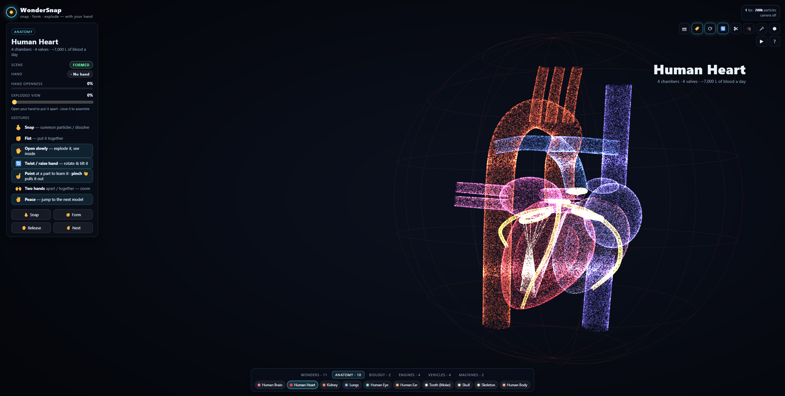

# Live It

**Gesture-controlled 3D models made of glowing light particles, running entirely in your browser.**

Hold three fingers up in front of your webcam and up to 250,000 GPU particles swirl into existence. Make a fist and they
form the Human Brain, a beating heart or a V8 engine. Open your hand and the model morphs into the next one, or
explodes into a labelled diagram of every part. No mouse, no controller, no install beyond Node.js.



## Quick start

You need [Node.js](https://nodejs.org/) 18 or newer and a webcam (optional: everything also works with the mouse and
keyboard).

```bash
git clone https://github.com/AkbarSheikh-debug/wondersnap.git live-it
cd live-it
npm install
cp .env.example .env
# Set your account name and a long unique password in .env
npm run dev
```

Then open **http://localhost:5173**, sign in with the configured account, and click **Start with camera** or
**Continue without camera**.

The server uses one configured account and keeps sessions in memory for up to eight hours. Shell environment variables
override values in `.env`. The app stays locked if either credential is missing. The local `.env` file is ignored by
Git. This built-in server is intended for localhost; put it behind an HTTPS reverse proxy before exposing it remotely.

## Deploy to Vercel

The repository includes Vercel Functions for sign-in, sign-out, and AI requests, plus routing middleware that protects
the studio and its assets. Import the repository into Vercel with the project root set to the repository root; the
included `vercel.json` selects the static frontend and configures the Node.js functions.

Set these environment variables in the Vercel project settings for Production (and Preview if needed):

| Variable | Required | Value |
|---|---|---|
| `LIVEIT_USERNAME` | Yes | The account name for studio access |
| `LIVEIT_PASSWORD` | Yes | A long, unique account password |
| `LIVEIT_SESSION_SECRET` | Yes | A random secret of at least 32 characters (for example, generate one with `openssl rand -base64 32`) |
| `OLLAMA_URL` | For Ask AI | Base URL of an Ollama service reachable from Vercel; a local `localhost` URL will not work |
| `OLLAMA_MODEL` | No | Installed Ollama model name; defaults to `llama3.2` |

After setting the variables, redeploy from `main`. Sessions use signed, eight-hour cookies on Vercel; signing out clears
the current browser's cookie, but cannot revoke a copied cookie before it expires. AI requests have a 55-second
upstream timeout and need a publicly reachable, secured Ollama host.

## Studio modes

Open **Choose model** and select **Particle draw**, **Gesture keyboard**, **Ask AI**, or **Games**. In draw mode, move
any extended fingertip to add glowing, animated particles, or draw with a mouse. The on-screen keyboard uses each
extended fingertip from up to two hands; hold a fingertip steadily over a key for 3 seconds to press it. Mouse and
touch clicks are also supported; copy text into desktop Word, Excel, or another app. A browser cannot type directly
into native desktop applications.

The AI mode connects to a local [Ollama](https://ollama.com/) service. Install Ollama beside the Node server, run
`ollama pull llama3.2`, and set `OLLAMA_MODEL` in `.env` if you choose a different installed model. Configure
`OLLAMA_URL` there if Ollama is not listening at `http://127.0.0.1:11434`. Games includes Snake, two-player Chess,
and Memory cards.

> The browser only allows camera access on `localhost` or `https`, which is why the app comes with its own tiny
> local server. To use a different port: `npm start -- 8080`.

## How it works

| Layer | What it does |
|---|---|
| **Hand tracking** | [MediaPipe Hand Landmarker](https://ai.google.dev/edge/mediapipe/solutions/vision/hand_landmarker) tracks up to two hands (21 landmarks each) from the webcam, fully on-device |
| **Gesture recognition** | Hold index, middle and ring fingers up with thumb and pinky folded to summon/dissolve; fist, open, point, pinch, peace, hand twist/tilt and two-hand zoom are also recognized |
| **Particle engine** | A hand-written WebGL2 renderer. Particle physics runs on the GPU with transform feedback: no Three.js, no game engine, no framework |
| **Models** | 33 procedural models built from real measurements and sampled into point clouds, with named parts that can explode, glow and be pulled out |
| **Server** | A zero-dependency local Node.js server (`server.mjs`) or Vercel Functions |

Nothing is sent anywhere: the video never leaves your machine.

## Gestures

| Gesture | What it does |
|---|---|
| **Three fingers** | Hold index, middle and ring fingers up with thumb and pinky folded to summon particles or dissolve the current model. Space is also available. |
| ✊ **Fist** | Form the architecture model, organ or machine |
| ✋ **Open hand** | Architecture models morph to the next one. Organs, engines and vehicles **explode**: how far you open your hand sets how far the parts fly apart, and closing it puts them back together |
| 🔄 **Twist / raise your hand** | Turn and tilt the formed model |
| ☝️ **Point** | Hold your finger on a part to select it. It glows, and a card explains what it does |
| 🤏 **Pinch** | Activate the on-screen control under the cursor; pinch a selected part to pull it out or put it back |
| 🙌 **Two hands** | Move them apart or together to zoom |
| ✌️ **Peace** | Jump to the next model |

## Keyboard and mouse

| Key | Action |
|---|---|
| `Space` | Summon / dissolve particles |
| `F` / `O` / `V` | Fist / open hand / peace sign |
| `←` `→` | Previous / next model |
| `E`, `↑` `↓`, mouse wheel | Explode amount |
| `+` `-` `0`, ctrl + wheel | Zoom |
| `C` | Camera on/off |
| `L` | Part labels |
| `R` | Auto-rotate |
| `G` | Hand rotation on/off |
| `X` | Cut-away cross-section (`,` and `.` nudge the plane) |
| `Q` | Quiz mode |
| `M` | Voice commands and read-aloud |
| `K` | Record a video |
| `D` | Play the demo |
| `I` / `Esc` | Describe / deselect the selected part |
| `H` | Help |

Click a part to select it, drag to rotate.

## Features

- **Beating heart and breathing lungs.** The heart contracts in a lub-dub rhythm at 72 bpm, the lungs inflate every
  4.5 s, and pulses of light travel through them like blood or air.
- **Exploded views with named parts.** Every part has a leader-line label saying what it does.
- **Quiz mode.** "Find: Hippocampus": point at (or click) the right part. Five questions, with a score.
- **Voice control.** Say "show me the heart", "open it up", "where is the right atrium", "zoom in", "quiz" and more.
  Parts are read aloud with speech synthesis (Chrome or Edge).
- **Cut-away.** A cutting plane follows your hand and reveals a glowing cross-section.
- **Recording.** Save a WebM video of the scene.

## Models

| Category | Models |
|---|---|
| **Architecture (11)** | Turtle Tower, Eiffel Tower, Statue of Liberty, Burj Khalifa, Great Pyramid, Colosseum, Leaning Tower of Pisa, Taj Mahal, Big Ben, Christ the Redeemer, Sydney Opera House |
| **Anatomy (10)** | Brain, beating Heart, Kidney, breathing Lungs, Eye, Ear, Tooth, Skull, Skeleton, Human Body (skin, organs, nerves, arteries, veins, skeleton) |
| **Biology (2)** | DNA double helix that unzips, Animal cell |
| **Engines (4)** | Inline-4, Supercharged HEMI V8, Turbofan jet, 9-cylinder radial |
| **Vehicles (4)** | Sports car, Motorcycle, Airliner, Saturn V (with stage separation) |
| **Machines (2)** | Mechanical wristwatch, EV battery pack (280 cells, busbars, cooling, BMS) |

## Gesture sensitivity

The **Gesture sensitivity** control in the status panel defaults to **Standard**, which preserves the original gesture
thresholds. **More forgiving** slightly relaxes static hand-pose recognition and openness. The three-finger trigger and
pinch detection are unchanged, and the selection lasts only for the current page session.

## URL options

| Option | Effect |
|---|---|
| `?n=250000` | Particle count |
| `?model=12` | Start on a given model |
| `?autostart=camera` / `?autostart=nocamera` | Skip the start screen |
| `?trails=0` | Turn off particle trails |
| `?dpr=1` | Force the device pixel ratio (useful on slower GPUs) |

## Tests

41 end-to-end and unit tests with [Playwright](https://playwright.dev/), driving the real app with synthetic hands on
a deterministic clock.

```bash
npx playwright install chromium   # one time
npm test
```

| Spec | Covers |
|---|---|
| `auth.spec.js` | Protected app access, credential validation, and session logout |
| `app.spec.js` | The full gesture story, every model, explode/contract, keyboard, wheel, tabs, demo, phone layout, hand twist and tilt |
| `features.spec.js` | Heartbeat and breathing, two-hand zoom, point-to-pick, pinch-to-pull, quiz, voice commands, cut-away, video recording |
| `camera.spec.js` | Real `getUserMedia` to MediaPipe on Chromium's fake webcam, plus the camera-denied fallback |
| `gpu.spec.js` | The GPU physics shader matches its CPU twin to ~1e-7 in every mode |
| `logic.spec.js` | Pose classifiers, three-finger trigger, debouncer, state machine, controller, voice-command parser |
| `models.spec.js` | Every model is deterministic, finite and fast, with real measurements and correctly exploding parts |

## Project structure

```
index.html, styles.css     page and styles
server.mjs                 zero-dependency static server
models/                    MediaPipe hand landmark model
src/app.js                 render loop, explode, zoom, picking, quiz, cut-away, HUD, labels, demo
src/hands.js               webcam + MediaPipe Hand Landmarker
src/features.js            voice commands, read-aloud, video recorder
src/gl/                    WebGL2 shaders and renderer (transform-feedback physics)
src/logic/                 gestures, state machine, controller, CPU physics twin
src/lib/                   vector math, samplers, procedural shapes
src/models/                wonders, anatomy, biology, engines, vehicles, machines
tests/                     Playwright specs
```

## Troubleshooting

- **Camera doesn't start:** open the app via `http://localhost:5173`, not by double-clicking `index.html`, and allow
  camera access when the browser asks.
- **Hand tracking never loads:** run `npm install` first; the tracking runtime is served from `node_modules`.
- **Low frame rate:** try `http://localhost:5173/?n=100000&dpr=1`.
- **Port already in use:** `npm run dev -- 8080` and open `http://localhost:8080`.
- **Sign-in is not configured:** set `LIVEIT_USERNAME` and `LIVEIT_PASSWORD` before starting the server.

## License

[MIT](LICENSE) © 2026 Hyacinth Onchangu
